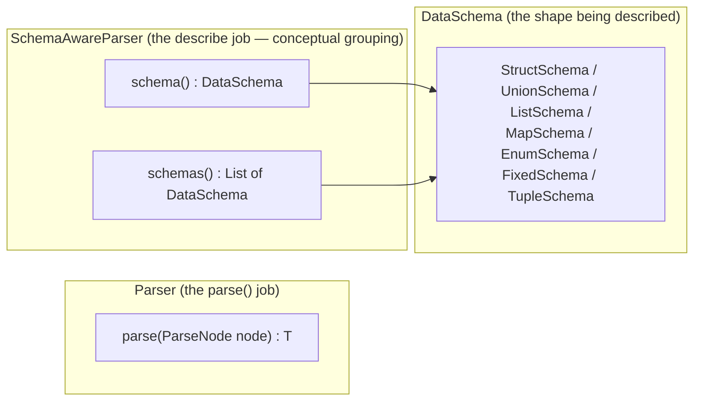
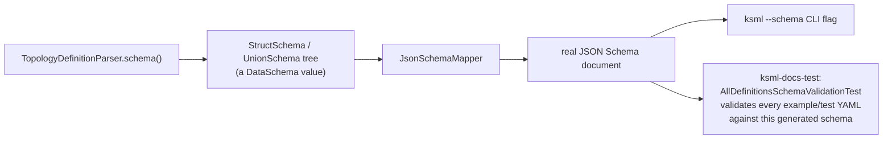
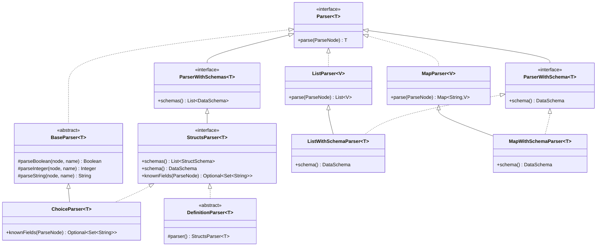
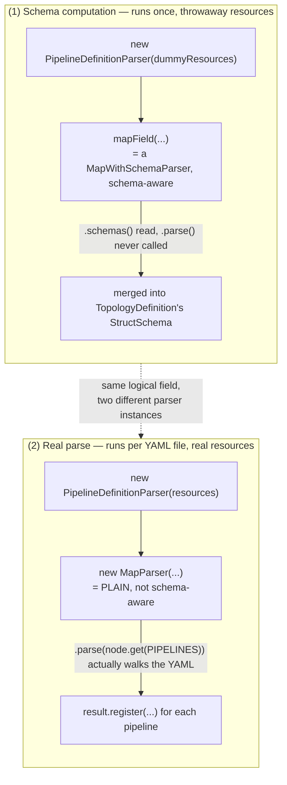

# How KSML parses a definition

This chapter explains, in broad lines, how a KSML definition file is turned into Java objects. It uses the simplest useful definition as an example.

```yaml
streams:
  input:  { topic: in_topic,  keyType: string, valueType: string }
  output: { topic: out_topic, keyType: string, valueType: string }

pipelines:
  copy:
    from: input
    to: output
```

## 1. YAML becomes a tree

Jackson reads the file into a tree of nodes. Duplicate keys are rejected at this step. Each node is wrapped in a `ParseNode`, which also remembers its path, for example `pipelines->copy->to`. Error messages use that path.

## 2. One parser per level

The parsers are nested the same way as the YAML:

```
TopologyDefinitionParser            the whole file
 ├─ streams:   a map  → StreamDefinitionParser for each entry (input, output)
 └─ pipelines: a map  → PipelineDefinitionParser for each entry (copy)
                          ├─ from: → a "resource" parser
                          └─ to:   → a "resource" parser
```

Each parser gets the node for its level and returns a Java object, for example `StreamDefinition`, `PipelineDefinition` or `TopologyDefinition`.

## 3. A parser only asks for the fields it knows

An object parser, such as `PipelineDefinitionParser`, is built from small field parsers: one for `from`, one for `to`, one for `via`, one for `as`, and so on. Each field parser does one thing: "get my key from this object and parse its value". If the key is missing, an optional field returns `null`.

When all field parsers are done, their results go into one constructor, for example `new PipelineDefinition(...)`.

## 4. How the parts of a pipeline are filled in

Streams are parsed first and collected. Then each pipeline is parsed:

- **`from: input`** is a plain name, so the parser looks it up among the streams that were just parsed. If `from` held an object instead of a name, it would be parsed as an inline definition.
- **`to: output`** works the same way.
- **`via`** (the list of steps) is missing in the example, so it becomes an empty list. Each step in `via` is parsed by a parser that first reads `type:` (for example `filter`). It then hands the step to the parser for that operation.

## 5. Every parser also describes its own shape

Besides parsing, each parser knows its fields. The published language schema (`ksml --schema`) is built from this. The schema says that no other fields are allowed.

## 6. Unknown fields are rejected

The field parsers never look at which keys are actually in the YAML; they only ask for the keys they know. So a separate check is needed to catch typos. Before KSML 2.0 there was no such check: with `copy: { from: input, to: output, tu: x }`, nobody asked for `tu`, and it was silently ignored.

Now, wherever an object is handed to its parser, KSML compares the object's keys with the fields that parser knows, and stops with an error for the keys that do not belong. That happens for each map entry, each list entry, each nested object, and the whole file. For a step with `type:`, only the fields of the chosen operation count. The example above now gives:

```
Error in input node ns->pipelines->copy: Unknown field "tu", known fields: as, branch, forEach, from, name, print, to, toTopicNameExtractor, via
```

## Where the field knowledge lives

There is no central list of allowed fields. Each parser knows only its own level, and the full picture comes from nesting the parsers.

Inside one parser, the field list is written once: the field parsers that are passed to `FieldParsers.structsParser(...)`. That one list is used for both:

- **parsing:** each field parser asks for its own key;
- **the schema:** each field parser adds its field.

So "which fields to ask for" and "which fields are allowed" come from the same declaration. The unknown-field check uses the schema side, so it does not add a new list that must be kept up to date.

A few hand-written parsers keep reading and schema apart, so they can drift:

- **`TopologyDefinitionParser` (the top level):** reads `name`, `version` and `description` with its own field parsers, and adds them to its schema by hand.
- **`ChoiceParser`:** adds the `type` field to the schema by hand.
- **`ReduceOperationParser` and `JoinTargetDefinitionParser`:** look at some keys only to decide what to do.

Because of the check, such a drift is visible: a field that is read but missing from the schema is rejected as unknown. The tests that load all test definitions and examples catch that. This is how the missing top-level `name`, `version` and `description` were found and fixed.


# Parser Architecture: `parse()`, `schema()`, and `DataSchema`

This chapter explains the core parsing abstractions in `io.axual.ksml.parser` (and friends):
what `parse()` and `schema()`/`schemas()` are for, where they come from, why some parsers
have one and not the other, and how a single top-level call — `TopologyDefinitionParser`
parsing a KSML YAML file — uses both capabilities together to (a) parse a definition and
(b) produce the JSON Schema used to validate and document the KSML language.

## 1. The three abstractions, at a glance

Every parser in this codebase does at most two independent jobs:

- **Parse**: given actual input (a `ParseNode`), produce a value of type `T`.
- **Describe**: independent of any input, report the *shape* of the `T` it produces, as a
  `DataSchema` value.



"SchemaAwareParser" isn't a literal class in the codebase — it's the conceptual name for
*whichever* interface adds a `schema()`/`schemas()` method on top of `Parser<T>`. Concretely,
that's `ParserWithSchema<T>` (one schema) or `ParserWithSchemas<T>` (a list of schemas); see
§3. A concrete parser class either only implements `Parser<T>` (parse-only), or additionally
implements one of those two (schema-aware).

## 2. `Parser<T>` — the parse contract

```java
public interface Parser<T> {
    T parse(ParseNode node);
}
```

This is the root of everything. `ParseNode` is a thin wrapper around Jackson's `JsonNode`
(plus a parent chain for error-path reporting, e.g. `stream->pipelines->filter`). A
`Parser<T>` is a black box: the only way to learn what it accepts is to feed it input and see
whether it throws.

Two plain, non-schema-aware implementations of `Parser<T>` matter here:

- **`BaseParser<T>`** — abstract class. Adds three `protected` scalar-extraction helpers
  (`parseBoolean`, `parseInteger`, `parseString`) for pulling a named, typed child value off a
  `ParseNode`. No `schema()` of any kind.
- **`ListParser<V>` / `MapParser<V>`** — concrete, generic classes, siblings of each other.
  Each wraps one child `Parser<V> valueParser` plus a couple of tag-key strings, and repeatedly
  delegates to that child over `node.children(...)`, collecting results into a `List` (ordered,
  errors reported by index) or a `LinkedHashMap` (insertion-order preserved, errors reported by
  child name). Neither has a `schema()`/`schemas()` — they only know how to iterate and
  delegate. Before delegating an entry to a `StructsParser`, they run the unknown-field check
  (see "Rejecting unknown fields" in §4).

## 3. `ParserWithSchema<T>` and `ParserWithSchemas<T>` — the describe contract

Two independent interfaces, **not** one extending the other, both extending `Parser<T>`
directly:

```java
public interface ParserWithSchema<T> extends Parser<T> {
    DataSchema schema();               // exactly one shape
}

public interface ParserWithSchemas<T> extends Parser<T> {
    List<? extends DataSchema> schemas();   // possibly several alternative shapes
}
```

Both are otherwise inert: no parsing logic of their own beyond the inherited `parse()`, plus a
static `of(...)` factory for building a simple instance from a lambda and a schema (or a
supplier of one). They exist as two parallel shapes because some values genuinely have one
possible shape (a plain string field) and some can validly take several alternatives at once
(an optional field, or a union type) — `ParserWithSchemas` avoids forcing the single-shape case
through list-wrapper overhead by being a distinct sibling rather than "the plural is a special
case of the singular."

**Because `schema()`/`schemas()` are abstract interface methods, any concrete class that
implements one of these interfaces is *required* by the compiler to provide both the parse
logic and the describe logic.** There's no such thing as a class that "sort of" implements
`ParserWithSchema` — implementing it at all means both methods exist. That's why, for the
subset of parsers that are schema-aware, "does both parse and describe" isn't a convention,
it's structurally guaranteed.

`StructsParser<T>` — the interface almost everything in `DefinitionParser` is built around —
`extends ParserWithSchemas<T>` and narrows `schemas()`'s return type to
`List<StructSchema>` specifically (a legal covariant override, since `List<StructSchema>` is a
subtype of `List<? extends DataSchema>`), and adds a default `schema()` that returns the single
schema directly if there's only one, or wraps several in a `UnionSchema` otherwise. It also adds
a default `knownFields(ParseNode)`, which the unknown-field check uses (see "Rejecting unknown
fields" in §4).

## 4. `DataSchema` — what the shape actually *is*

`DataSchema` is a small family of value types describing a shape, independent of any
Java type or any specific piece of input:

| Type           | Describes                                                         |
|----------------|--------------------------------------------------------------------|
| `StructSchema` | A named object with typed, optionally-required, documented fields |
| `UnionSchema`  | "one of these alternative schemas"                                 |
| `ListSchema`   | A homogeneous list of some element schema                          |
| `MapSchema`    | A homogeneous map of some value schema, keyed by name              |
| `EnumSchema`   | A fixed set of named symbols                                        |
| `FixedSchema`  | A fixed-length byte sequence                                        |
| `TupleSchema`  | A fixed-arity heterogeneous sequence                                 |

A `DataSchema` value carries no parsing behavior — it's pure data, safely inspectable and
serializable. That's what makes it the right thing for `schema()`/`schemas()` to return: the
description can be extracted, combined, and converted **without ever calling `parse()`**.

### Where `schema()` gets its information from

The field-builder methods that build a `StructsParser<T>` — `stringField`, `booleanField`,
`listField`, `structsParser(...)`, `optional(...)`, `structSchema(...)`, and the rest — live as
static methods on a standalone `FieldParsers` utility class, callable as
`FieldParsers.stringField(...)`, `FieldParsers.structsParser(...)`, etc., without requiring a
class to extend anything. Each one builds **both** halves from the same declaration at the same
time: a parse function *and* a `DataSchema` fragment (name, type, doc string, tag,
required/optional, union alternatives). `structsParser(...)` combines several such (parser,
schema) pairs into one combined `StructsParser<T>` whose `schemas()` merges the individual field
schemas into one `StructSchema`. So a class's `schema()`/`schemas()` output isn't computed by
inspecting the class or by reflection — it's built up field-by-field, out of the exact same
`FieldParsers` calls that also produce the parse behavior. That's the "parse ⊗ describe"
combinator design: for parsers built this way, the two stay in step because they're two views of
one declaration. A few hand-written parsers keep parsing and schema apart (see "Rejecting unknown
fields" below); there, the unknown-field check turns any drift into a parse error.

These methods are stateless — they don't depend on any parser's resources or identity, only on
their own arguments — which is why they live on `FieldParsers` rather than as inherited instance
methods: any class can call them without needing to extend a particular parent.

### What the `DataSchema` tree is used for



`JsonSchemaMapper` walks the `DataSchema` tree and emits an actual JSON Schema document. That
document is what `ksml --schema` prints, and what `ksml-docs-test` uses to validate every
example/test KSML YAML file — generated from the exact same parser code that does the real
parsing. Because the parser rejects every field that this schema does not list (see below), a
definition that parses also validates against the schema, and the other way round.

### Rejecting unknown fields

The field parsers only ask for the keys they know (`node.get("from")`); nothing in them looks at
which keys are actually present. So a separate check rejects keys that the parser for an object
does not know. It uses the schema side of the parsers, so there is no second list of allowed
fields to maintain:

- **`StructsParser.knownFields(ParseNode node)`** returns an `Optional` with the field names of
  all the parser's `schemas()`. It is empty when a schema allows additional fields (for example
  `StructSchema.SCHEMALESS`, used by `IgnoreParser`), which means "any field is allowed". An
  empty `Optional` is not the same as an empty set: an empty set would mean "no field is
  allowed".
- **`ChoiceParser`** (the `type:` field on operations, functions and stores) overrides it: it
  returns the `type` field plus the known fields of the *chosen* variant only, so a field of
  another type is rejected. The chosen variant can itself be a choice (`windowByTime` picks its
  variant with `windowType`), so the call goes on to the variant. For an invalid `type`, it
  returns an empty `Optional`, and `parse()` reports the invalid type instead.
- **`DefinitionParser`** and **`StructsParser.lazy`** pass the call on to their delegate.
- **`FieldParsers.checkKnownFields(ParseNode, StructsParser<?>)`** does the check: for an object
  node, it compares the keys with `knownFields`, and throws a `ParseException` that names the
  path, all unknown fields and the known fields.

The check runs where an object is handed to its parser:

- `FieldParser` (a field whose value parser is a `StructsParser`);
- `MapParser` and `ListParser` (each entry);
- `TopologyResourceParser` (an inline definition);
- the root, in `TopologyDefinitionParser` (§7).

It does not run inside the `ValueStructParser` that `structsParser(...)` builds, because a
variant's own parser does not know the `type` field that `ChoiceParser` adds.

```
Error in input node ns->pipelines->copy: Unknown field "tu", known fields: as, branch, forEach, from, name, print, to, toTopicNameExtractor, via
```

A few hand-written parsers keep reading and schema apart, so they need care:

- **`TopologyDefinitionParser`** reads `name`, `version` and `description` with its own field
  parsers, and adds their fields to the root schema by hand.
- **`ChoiceParser`** adds the `type` field to the schema by hand.
- **`ReduceOperationParser`** and **`JoinTargetDefinitionParser`** look at some keys only to
  decide which variant applies. Without a `type:` field, the known fields are the union of the
  variants, so a field of a sibling variant is not rejected there.

A field that a parser reads but leaves out of its schema is rejected as unknown, and the tests
that parse all test definitions and examples catch that.

## 5. Class/interface map



Reading this: `BaseParser`, `ListParser`, `MapParser` are parse-only. `ParserWithSchema` and
`ParserWithSchemas` are independent, parse+describe contracts. `StructsParser` is the
plural-schema contract, narrowed to `StructSchema` specifically, that the whole KSML-definition
parsing hierarchy (`DefinitionParser` and everything under it) is built on. `ListWithSchemaParser`
/ `MapWithSchemaParser` show the one place a plain collection parser gets upgraded to
schema-aware by subclassing and additionally implementing `ParserWithSchema`. `ChoiceParser`
uses the `BaseParser` helpers and is also a `StructsParser`; it overrides `knownFields` to
narrow it to the chosen variant.

## 6. The role of plain (parse-only) parsers

Plain parsers show up for two different reasons, not one:

**Reason A — mechanical "iterate and dispatch" glue, where the shape is already known.**
Within the schema-aware `DefinitionParser` lineage, a plain `ListParser`/`MapParser` sometimes
appears wrapping an already schema-aware value parser, purely to walk a YAML list/map and
delegate each entry — because the *container's* schema was already computed separately,
elsewhere, and recomputing it here would be redundant. See §7 for the concrete example.

**Reason B — an entire sub-language that has no schema at all.** The
`io.axual.ksml.schema.parser.*` package (which parses the schema-*definition* DSL itself — the
format used to declare KSML struct/enum/union types) extends `BaseParser` directly, not
`DefinitionParser`, and uses plain `ListParser`/`MapParser` throughout. There's no
"schema of a schema declaration" being generated for that sub-language, so schema-awareness
never enters the picture there at all.

## 7. Worked example: `TopologyDefinitionParser`

`TopologyDefinitionParser` is the root parser for an entire KSML YAML definition. Its
`parser()` method does two genuinely separate things, computed at two different times, using
two different parser instances for the same logical content:

```java
public StructsParser<TopologyDefinition> parser() {
    final var dummyResources = new TopologyResources("dummy");
    // (1) SCHEMA computation — runs once, uses a throwaway empty TopologyResources.
    //     parse() is never called on these instances; only .schemas() is read.
    final var pipelinesParser = FieldParsers.optional(FieldParsers.mapField(
            PIPELINES, PIPELINE, PIPELINE, "Collection of named pipelines",
            new PipelineDefinitionParser(dummyResources)));
    final var producersParser = FieldParsers.optional(FieldParsers.mapField(
            PRODUCERS, PRODUCER, PRODUCER, "Collection of named producers",
            new ProducerDefinitionParser(dummyResources)));

    // The top-level fields are read with their own field parsers...
    final var nameParser = FieldParsers.withDefault(FieldParsers.optional(
            FieldParsers.stringField(KSMLDSL.NAME, true, "The name of the topology")), "<anonymous topology>");
    final var versionParser = ...;      // same pattern for "version"
    final var descriptionParser = ...;  // same pattern for "description"

    // ...and their fields are added to the root schema by hand, so the unknown-field check accepts them
    final var fields = new ArrayList<StructSchema.Field>();
    fields.addAll(nameParser.schemas().getFirst().fields());
    fields.addAll(versionParser.schemas().getFirst().fields());
    fields.addAll(descriptionParser.schemas().getFirst().fields());
    fields.addAll(resourcesParser.schemas().getFirst().fields());
    fields.addAll(pipelinesParser.schemas().getFirst().fields());
    fields.addAll(producersParser.schemas().getFirst().fields());
    final var schemas = List.of(FieldParsers.structSchema(TopologyDefinition.class, "KSML definition", fields));

    return new StructsParser<>() {
        @Override
        public TopologyDefinition parse(ParseNode node) {
            // (2) REAL parse — runs per actual YAML file, uses the real resources.
            // The root is not handed over by another parser, so it checks its own fields.
            FieldParsers.checkKnownFields(node, this);
            final var name = nameParser.parse(node);
            ...
            final var resources = resourcesParser.parse(node);
            final var result = new TopologyDefinition(resources.namespace(), name, version, description);
            resources.topics().forEach(result::register);
            resources.stateStores().forEach(result::register);
            resources.functions().forEach(result::register);
            // A fresh, PLAIN MapParser does the actual iteration + dispatch
            // (and the unknown-field check for each pipeline and producer):
            new MapParser<>(PIPELINE, "pipeline definition", new PipelineDefinitionParser(resources))
                    .parse(node.get(PIPELINES)).forEach(result::register);
            new MapParser<>(PRODUCER, "producer definition", new ProducerDefinitionParser(resources))
                    .parse(node.get(PRODUCERS)).forEach(result::register);
            return result;
        }

        @Override
        public List<StructSchema> schemas() {
            return schemas;
        }
    };
}
```

`FieldParsers.optional`, `FieldParsers.mapField`, and `FieldParsers.structSchema` here are called
explicitly because they're static utility methods, not inherited instance methods —
`TopologyDefinitionParser extends DefinitionParser<TopologyDefinition>`, but `DefinitionParser`
itself no longer provides any field-builder methods to inherit. `MapParser` is unrelated either
way — it was never one of the `FieldParsers` methods; it's a plain, always-standalone class.



The value parser passed into both (`PipelineDefinitionParser`) is schema-aware either way — the
field-level semantics (what a pipeline contains, its types, docs, validation) are always
implemented by schema-aware parsers, because that's the only mechanism that produces a
`DataSchema` at all. The difference is only in the *outer wrapper*: `mapField` (schema-aware,
used once to describe the "pipelines" container) versus a plain `MapParser` (used every time,
to actually walk it). This is why plain parsers "play a role" in real parsing without being
where the real work happens: they're the mechanical last mile between a container node and its
already-described, already-schema-aware children.

## 8. Summary

| | `parse()` | `schema()` / `schemas()` |
|---|---|---|
| `Parser<T>` | ✓ (the only thing it has) | — |
| `BaseParser`, `ListParser`, `MapParser` | ✓ | — |
| `ParserWithSchema<T>` | ✓ (inherited) | ✓ (exactly one `DataSchema`) |
| `ParserWithSchemas<T>` | ✓ (inherited) | ✓ (a list of `DataSchema`) |
| `StructsParser<T>` | ✓ (inherited) | ✓ (`List<StructSchema>`, plus default `schema()`) |
| `ListWithSchemaParser`, `MapWithSchemaParser` | ✓ (inherited from `ListParser`/`MapParser`) | ✓ (`ParserWithSchema`) |
| `DefinitionParser<T>` and everything under it (all KSML definition/operation parsers) | ✓ | ✓ |
| `io.axual.ksml.schema.parser.*` (the schema-definition DSL) | ✓ | — (no schema-of-a-schema is ever produced) |

The one-line version: **`parse()` turns real input into a value; `schema()`/`schemas()`
describes, independent of input, what shape that value takes, as a `DataSchema`; and that
`DataSchema` tree is what `JsonSchemaMapper` turns into the real JSON Schema behind
`ksml --schema` and `ksml-docs-test`.** Plain parsers exist wherever only the first half is
needed — either as thin iterate-and-dispatch glue around already-described children, or in an
entire sub-language (the schema-definition DSL) that was never meant to describe itself.
