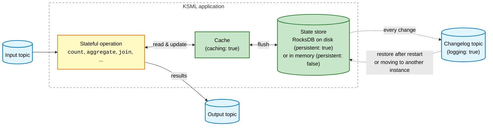
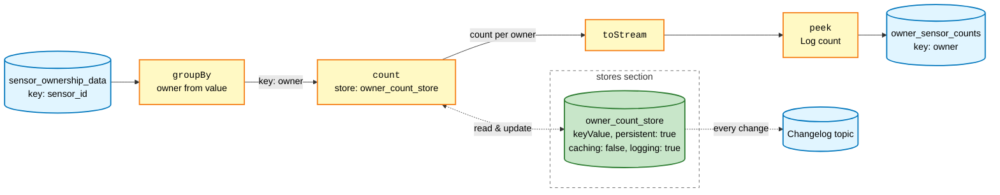
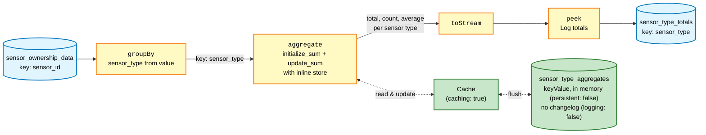

# State Stores

State stores are persistent or in-memory storage components used by stateful operations in Kafka Streams to maintain intermediate results, aggregations, and other stateful data. KSML provides flexible configuration options for state stores, allowing you to optimize performance, durability, and storage characteristics for your specific use cases.

## Prerequisites

Before starting this tutorial:

- Have [Docker Compose KSML environment setup running](../../getting-started/basics-tutorial.md#choose-your-setup-method)
- Add the following topics to your `kafka-setup` service in docker-compose.yml to run the examples:

??? info "Topic creation commands - click to expand"

    ```yaml
    kafka-topics.sh --create --if-not-exists --bootstrap-server broker:9093 --partitions 1 --replication-factor 1 --topic sensor_ownership_data && \
    kafka-topics.sh --create --if-not-exists --bootstrap-server broker:9093 --partitions 1 --replication-factor 1 --topic owner_sensor_counts && \
    kafka-topics.sh --create --if-not-exists --bootstrap-server broker:9093 --partitions 1 --replication-factor 1 --topic sensor_type_totals && \
    kafka-topics.sh --create --if-not-exists --bootstrap-server broker:9093 --partitions 1 --replication-factor 1 --topic owner_counts && \
    ```

## Understanding State Stores in Kafka Streams

State stores serve several critical purposes in stream processing:

- **Aggregations**: Store running totals, counts, averages, and other aggregate calculations
- **Windowing**: Maintain data within time windows for temporal analysis
- **Joins**: Cache data from one stream to join with another
- **Deduplication**: Track processed records to eliminate duplicates
- **State Management**: Persist application state across restarts

State stores can be backed by RocksDB (persistent) or kept in memory (non-persistent). Both types can optionally use changelog topics for fault tolerance and recovery.

The diagram below shows where a state store lives and how the optional settings fit together. The store itself is
local to the KSML application; the changelog topic in Kafka is its backup:



Without caching, the operation reads and writes the store directly. Without logging, there is no changelog topic: a
persistent store still survives a restart on the same machine, but its state is lost if the application moves to
another machine or the local files are deleted.

## State Store Types

KSML supports three types of state stores. For detailed information about each type and their parameters, see the [State Store Reference](../../reference/state-store-reference.md#state-store-types).

## Configuration Methods

KSML provides two ways to configure state stores:

### 1. Predefined Store Configuration

Define stores in the global `stores` section and reference them by name:

??? info "Sensor Ownership Producer (click to expand)"

    ```yaml
    
    ```

??? info "Predefined Store Processor (click to expand)"

    ```yaml
    
    ```

This example demonstrates:

- **Predefined store configuration**: The `owner_count_store` is defined in the global `stores` section
- **Store reference**: The `count` operation references the predefined store by name
- **Persistent storage**: Data survives application restarts (`persistent: true`)
- **Changelog logging**: State changes are replicated to a Kafka changelog topic for fault tolerance and recovery (`logging: true`)



You won't be able to read the output in `owner_sensor_counts` topic because it is binary, to read it you can consume the messages like this:

   ```bash
   # Read owner sensor counts (Long values require specific deserializer)
   docker exec broker /opt/bitnami/kafka/bin/kafka-console-consumer.sh \
     --bootstrap-server broker:9093 \
     --topic owner_sensor_counts \
     --from-beginning \
     --key-deserializer org.apache.kafka.common.serialization.StringDeserializer \
     --value-deserializer org.apache.kafka.common.serialization.LongDeserializer \
     --property print.key=true \
     --property key.separator=": " \
     --timeout-ms 10000
   ```

### 2. Inline Store Configuration

Define stores directly within operations for single-use scenarios:

??? info "Sensor Ownership Producer (click to expand)"

    ```yaml
    
    ```

??? info "Inline Store Processor (click to expand)"

    ```yaml
    
    ```

This example demonstrates:

- **Inline store configuration**: Store defined directly within the `aggregate` operation
- **Custom aggregation**: Uses initializer and aggregator functions for complex calculations
- **Memory-only storage**: Non-persistent storage for temporary calculations (`persistent: false`)
- **Caching enabled**: Improves performance by batching state updates (`caching: true`)



Compared to the predefined store above, this store has no changelog topic and lives only in memory: after a restart,
the totals start again from zero.

## Configuration Parameters

For a complete list of configuration parameters for all store types, see the [State Store Reference - Configuration Parameters](../../reference/state-store-reference.md#configuration-parameters).

## Best Practices

### When to Use Predefined Stores
- Multiple operations need to access the same store
- Store configuration is complex or frequently reused
- You want centralized store management for maintainability

### When to Use Inline Stores
- Store is used by a single operation
- Simple, one-off configurations
- Prototyping or small applications

### Memory Management
- Set appropriate retention periods to prevent unbounded growth
- Use non-persistent stores for temporary calculations
- Monitor memory usage, especially with caching enabled

### Fault Tolerance
- Enable logging for critical business data
- Use persistent stores for data that must survive restarts
- Consider the trade-off between durability and performance

State stores are a powerful feature in KSML that enable sophisticated stateful stream processing patterns. By understanding the configuration options and trade-offs, you can build robust and efficient streaming applications.

## Next Steps

Ready to explore more advanced state store patterns? Continue with:

- **[Custom State Stores Tutorial](../advanced/custom-state-stores.md)** - Learn advanced patterns including window stores, session stores, multi-store coordination, and optimization techniques for production applications