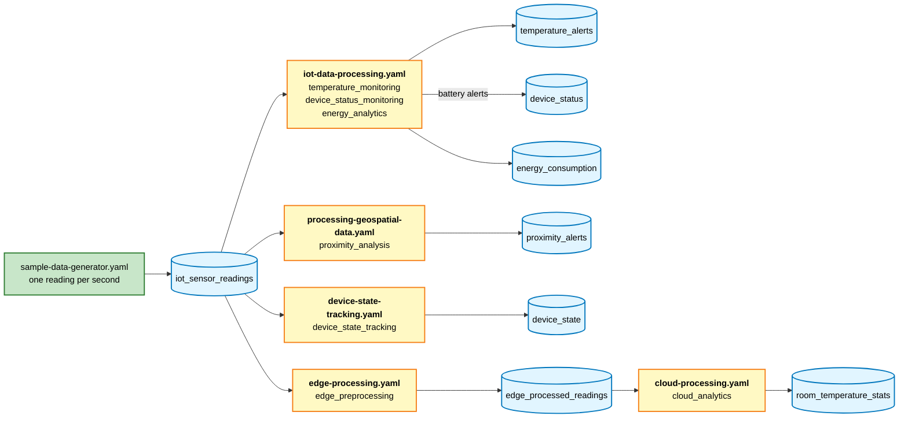
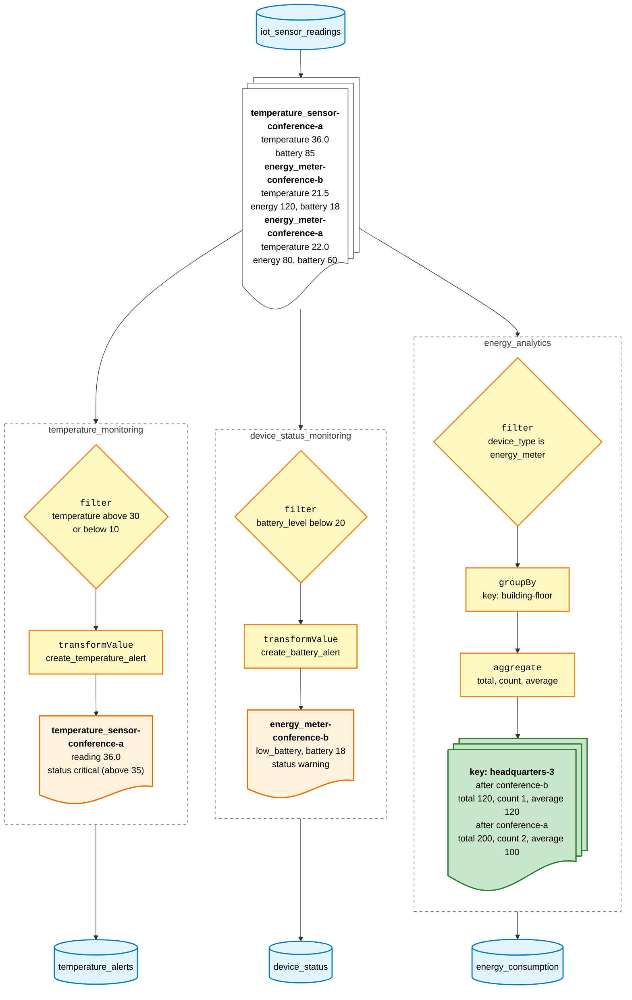
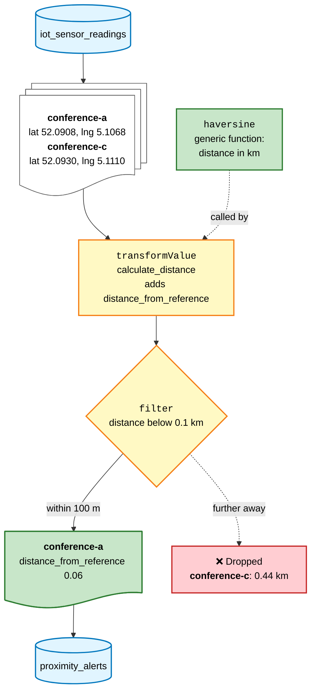
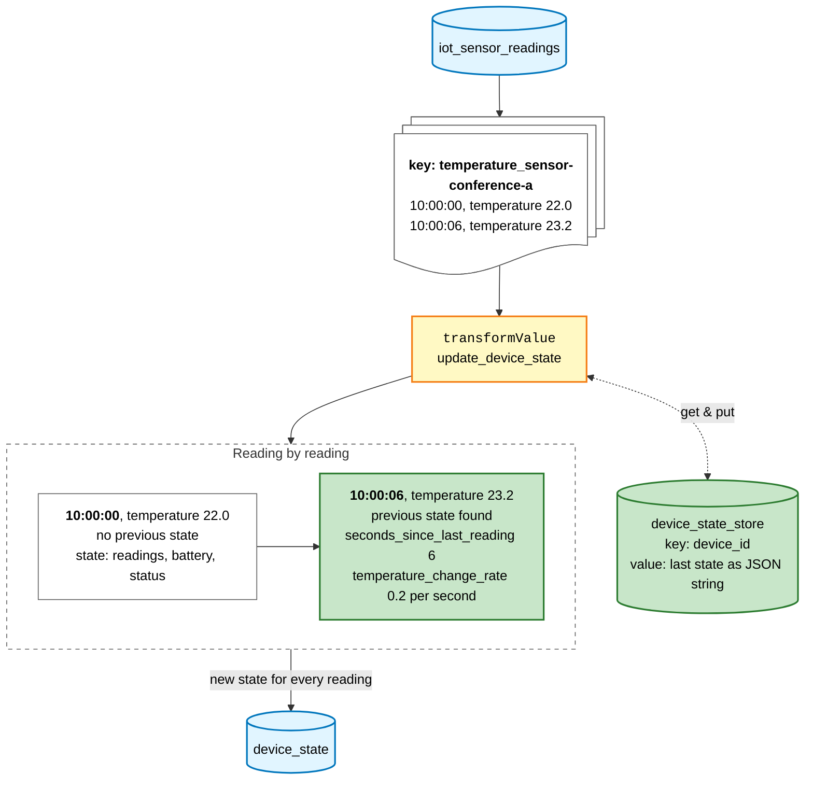
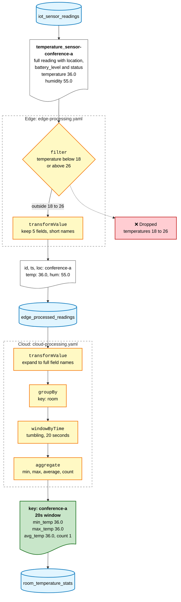

# IoT Data Processing with KSML

This guide demonstrates how to build an IoT data processing application using KSML. You'll learn how to ingest, process, and analyze high-volume sensor data from IoT devices.

## Introduction

Internet of Things (IoT) applications generate massive amounts of data from distributed sensors and devices. Processing this data in real-time presents several challenges:

- Handling high-volume, high-velocity data streams
- Managing device state and context
- Processing geospatial data
- Implementing edge-to-cloud data pipelines
- Detecting anomalies and patterns in sensor readings

KSML provides powerful capabilities for building scalable IoT data processing pipelines that address these challenges.

## Prerequisites

Before starting this guide, you should:

- Understand basic KSML concepts (streams, functions, pipelines)
- Have completed the [KSML Basics Tutorial](../getting-started/basics-tutorial.md)
- Be familiar with [Aggregations](../tutorials/intermediate/aggregations.md)
- Have a basic understanding of [State Stores](../tutorials/intermediate/state-stores.md)

## The Use Case

Imagine you're managing a smart building system with thousands of IoT sensors monitoring:

- Temperature and humidity in different rooms
- Energy consumption of various appliances and systems
- Occupancy and movement patterns
- Air quality metrics

You want to process this data in real-time to:

1. Monitor building conditions and detect anomalies
2. Optimize energy usage based on occupancy patterns
3. Track device health and identify maintenance needs
4. Generate aggregated analytics for building performance

## Define the topics for the use case

In earlier tutorials, you created a Docker Compose file with all the necessary containers. For this use case guide, some other topics
are needed.
To have these created, open the `docker-compose.yml` in the examples directory, and find the definitions for the `kafka-setup` container
which creates the topics.
<br>
Change the definition so that the startup command for the setup container (the `command` section) looks like the following:

??? info "`command` section for the kafka-setup container (click to expand)"

    ```yaml
    command: "bash -c 'echo Creating topics... && \
                           kafka-topics.sh --create --if-not-exists --bootstrap-server broker:9093 --partitions 1 --replication-factor 1 --topic iot_sensor_readings && \
                           kafka-topics.sh --create --if-not-exists --bootstrap-server broker:9093 --partitions 1 --replication-factor 1 --topic temperature_alerts && \
                           kafka-topics.sh --create --if-not-exists --bootstrap-server broker:9093 --partitions 1 --replication-factor 1 --topic device_status && \
                           kafka-topics.sh --create --if-not-exists --bootstrap-server broker:9093 --partitions 1 --replication-factor 1 --topic device_state && \
                           kafka-topics.sh --create --if-not-exists --bootstrap-server broker:9093 --partitions 1 --replication-factor 1 --topic energy_consumption && \
                           kafka-topics.sh --create --if-not-exists --bootstrap-server broker:9093 --partitions 1 --replication-factor 1 --topic proximity_alerts && \
                           kafka-topics.sh --create --if-not-exists --bootstrap-server broker:9093 --partitions 1 --replication-factor 1 --topic edge_processed_readings && \
                           kafka-topics.sh --create --if-not-exists --bootstrap-server broker:9093 --partitions 1 --replication-factor 1 --topic room_temperature_stats'"
    ```

## Defining the Data Model

Our IoT sensor data will have the following structure:

```json
{
  "device_id": "sensor-123",
  "timestamp": 1625097600000,
  "device_type": "temperature_sensor",
  "location": {
    "building": "headquarters",
    "floor": 3,
    "room": "conference-a",
    "coordinates": {
      "lat": 52.0908,
      "lng": 5.1068
    }
  },
  "readings": {
    "temperature": 22.5,
    "humidity": 45.2,
    "energy": 70
  },
  "battery_level": 87,
  "status": "active"
}
```

## Overview of the Definitions

This guide contains five KSML definitions and a sample data generator. All definitions read the same
`iot_sensor_readings` topic, and each one writes its results to its own output topic. The edge and cloud definitions
are chained through `edge_processed_readings`:



The sample generator cycles through three rooms (`conference-a`, `conference-b`, `conference-c`) and two device types
(`temperature_sensor`, `energy_meter`), so there are six devices, such as `temperature_sensor-conference-a`. Every
reading contains a temperature, a humidity and an energy value, whatever the device type.

## Creating the KSML Definition

Now, let's create our KSML definition file:

??? info "IoT data processor (click to expand)"

    ```yaml
    
    ```


The definition runs three independent pipelines on every reading. The diagram below follows three example readings:



The temperature check applies to all device types, not only to temperature sensors. Temperatures between 30 and 35 (or
between 5 and 10) create a `warning` alert; further out of range, the alert is `critical`. All rooms in the sample data
are on floor 3 of the same building, so the energy aggregation has a single key, `headquarters-3`.

## Processing Geospatial Data

IoT applications often involve geospatial data processing. Here's how to handle location-based analytics with KSML:

??? info "Geospatial data processor (click to expand)"

    ```yaml
    
    ```


The pipeline adds the distance between the device and a fixed reference point (latitude 52.0903, longitude 5.1063)
to every reading, and only keeps readings from devices within 100 meters of that point. The diagram below follows readings
from two rooms:

<div style="width: 50%; margin: 0 auto;" markdown>



</div>

The sample data generator places the three rooms about 60, 200 and 440 meters from the reference point, so only the
readings from `conference-a` are written to `proximity_alerts`.

## Implementing Device State Tracking

For many IoT applications, tracking device state over time is crucial. Here's how to implement this using KSML's state stores:

??? info "Device state tracking processor (click to expand)"

    ```yaml
    
    ```


The function keeps the last state of every device in `device_state_store`. From the second reading on, it compares the
new reading with the stored one. The diagram below follows two readings of one device, 6 seconds apart:



## Edge-to-Cloud Processing

IoT architectures often involve processing at the edge before sending data to the cloud. KSML can be deployed at both edge and cloud levels:

### Edge Processing

At the edge, you might want to reduce the amount of data before sending it to the cloud. This example only forwards
temperatures outside the comfortable range, and shortens the payload:

??? info "Edge processing pipeline (click to expand)"

    ```yaml
    
    ```

### Cloud Processing

In the cloud, you can perform more complex analytics and aggregations:

??? info "Cloud processing pipeline (click to expand)"

    ```yaml
    
    ```


The edge definition writes a small payload to `edge_processed_readings`, and the cloud definition reads it from there.
The diagram below follows one reading through both definitions:

<div style="width: 60%; margin: 0 auto;" markdown>



</div>

The sample data generator produces temperatures between 19 and 24, and an out-of-range value (4.0, 8.0, 32.0 or 36.0)
every 50th reading. Only those values pass the edge filter, so `room_temperature_stats` gets a new result about once every
50 seconds.

## Testing and Validation

To test your IoT data processing pipeline:

1. Generate sample IoT data using a simulator or replay historical data
2. Deploy your KSML application using the [proper configuration](../reference/configuration-reference.md)
3. Monitor the output topics to verify correct processing
4. Use visualization tools to display the processed data

The following producer pipeline can serve as a starting point to generate sample data. This pipeline will produce sample
measurements from three separate rooms with two sensors each, containing randomized data. Occasionally some outlier values
are generated so that the alerts will be visible.

??? info "IoT sample data generator (click to expand)"

    ```yaml
    
    ```

The following runner configuration runs the sample data generator and all five definitions together:

??? info "KSML runner configuration (click to expand)"

    ```yaml
    
    ```

## Production Considerations

When deploying IoT data processing pipelines to production:

1. **Scalability**: Ensure your Kafka cluster can handle the volume of IoT data
2. **Fault Tolerance**: Configure proper replication and error handling
3. **Data Retention**: Set appropriate retention policies for raw and processed data
4. **Security**: Implement device authentication and data encryption
5. **Monitoring**: Set up alerts for anomalies in both the data and the processing pipeline
6. **Edge Deployment**: Consider deploying KSML at the edge for preprocessing

## Conclusion

KSML provides a powerful and flexible way to process IoT data streams. By combining real-time processing with state management and windowed operations, you can build sophisticated IoT applications that derive valuable insights from your device data.

For more advanced IoT scenarios, explore:

- [Complex Event Processing](../tutorials/advanced/complex-event-processing.md) for pattern detection
- [Custom Functions](../reference/function-reference.md) for domain-specific processing
- [KSML Definition Reference](../reference/definition-reference.md) for a full explanation of the KSML definition syntax
